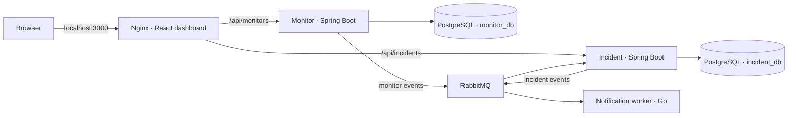

# OpsPilot

OpsPilot monitors HTTP endpoints, opens and resolves incidents, and delivers notifications. The React dashboard shows endpoint health, response-time history, and incident timelines. Operators can manage monitors and acknowledge incidents from the dashboard.

## Quick start

Requires Docker Engine with BuildKit and Docker Compose 2.17+. The smoke test also requires `curl` and Python 3.

```bash
test -f .env || cp .env.example .env
docker compose up -d --build --wait
./scripts/smoke-test.sh
```

Open the [dashboard](http://localhost:3000). Use `docker compose ps` to check container health and `docker compose logs -f gateway monitor-service incident-service notification-service` to follow logs. Use `docker compose down` to stop the stack and keep its volumes.

## Architecture



Nginx publishes only `127.0.0.1:3000`. The gateway health endpoint is `/healthz`. Service health endpoints stay internal.

One successful check marks a new monitor up. Three consecutive failures mark it down, and two consecutive successes recover it. The Spring services publish events through PostgreSQL outboxes. The Go worker records durable delivery receipts and sends webhook notifications when `NOTIFICATION_WEBHOOK_URL` is set.

| API | Operations |
|---|---|
| `/api/monitors` | List and create monitors |
| `/api/monitors/{id}` | Read, update, and delete a monitor |
| `/api/monitors/{id}/enabled`, `/api/monitors/{id}/checks` | Enable or disable checks and read recent history |
| `/api/incidents`, `/api/incidents/{id}` | List and read incidents |
| `/api/incidents/{id}/transitions`, `/api/incidents/{id}/acknowledge` | Read transition history and acknowledge an open incident |

## Frontend development

With Node.js 24 installed and the gateway running, start Vite at [127.0.0.1:5173](http://127.0.0.1:5173). API requests still go through Nginx.

```bash
npm ci --prefix frontend
npm run dev --prefix frontend
```

See the [dashboard design system](DESIGN.md).

## Continuous integration

GitHub Actions runs the Java, Go, frontend, and Compose checks on every pull request and push to `main`. The integration job builds all four application images, starts PostgreSQL and RabbitMQ, and exercises the gateway, monitor API, incident lifecycle, and notification delivery. `CI Gate` reports success only when every job passes.

See the [CI workflow and branch protection setup](docs/ci-cd-architecture.md).

## Release verification

Install Playwright and Chromium once. Run the release suite as your regular user.

```bash
npm ci --prefix tests/e2e
npm exec --prefix tests/e2e -- playwright install chromium
python3 scripts/test-release-acceptance.py
```

The runner starts the development fixtures and checks the gateway, APIs, frontend, and browser workflows. Add `--sudo-docker` if Docker requires sudo, or `--skip-stack-build` if the stack is already running with both development Compose overrides. Use a development stack because recovery tests deliberately stop and replace containers and leave test records.
