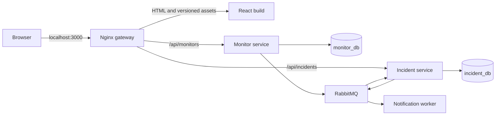
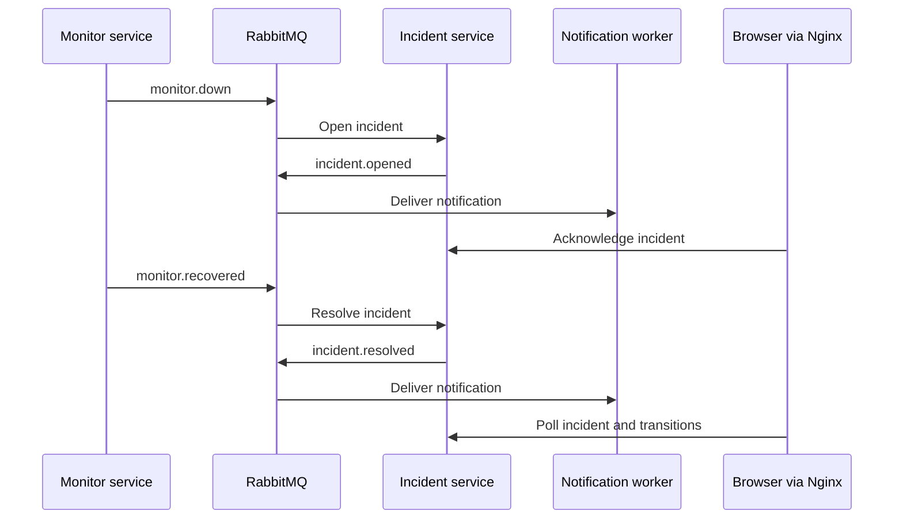

# OpsPilot

OpsPilot is a portfolio-focused, polyglot incident-management platform. Milestone 2 adds Monitor CRUD, automated health checks, a RabbitMQ event pipeline, and the Incident API to the three-service foundation.

## Architecture

| Service | Language | Local URL | Responsibility |
|---|---|---|---|
| gateway | Nginx | http://localhost:3000 | Serves the React dashboard and proxies the APIs |
| monitor-service | Java / Spring Boot | http://localhost:3000/api/monitors | Monitor CRUD API |
| incident-service | Java / Spring Boot | http://localhost:3000/api/incidents | Opens and resolves incidents from monitor events |
| notification-service | Go | internal only | Records incident notifications |
| PostgreSQL | database | internal only | Separate `monitor_db` and `incident_db` databases |
| RabbitMQ | messaging | internal only | Topic exchange for monitor and incident events |

The Java services run Flyway migrations against their respective databases at startup.



Nginx serves the dashboard and its deep links from the Vite build in the multi-stage image. The two API route families preserve their backend paths and response statuses. The dashboard and APIs share a browser origin, so requests use relative URLs. The gateway health probe is `/healthz`. Service health and Actuator routes stay internal.

HTML uses `Cache-Control: no-cache` so clients revalidate it promptly. Vite's content-hashed assets are immutable for one year. Security headers apply to both successful and failed responses. If Nginx cannot connect to an API or the upstream times out, it returns JSON with HTTP `502` or `504` and a request ID.

## Prerequisites

- Docker Engine with BuildKit and Docker Compose 2.17 or newer
- `curl` and Python 3 for smoke tests
- No local Java, Maven, Go, or database installation is required to use Compose.

## Quick start

```bash
test -f .env || cp .env.example .env
docker compose up --build -d --wait
docker compose ps
./scripts/smoke-test.sh
```

Open http://localhost:3000 for the dashboard. Overview pulls from both APIs, and the Monitors and Incidents pages show their respective collections. The gateway preserves upstream HTTP status codes and logs each response's `X-Request-ID`. The local gateway health endpoint at `/healthz` reports whether Nginx is responding. Compose checks the health of the Spring services, PostgreSQL, RabbitMQ, and the notification worker separately.

Check logs with `docker compose logs -f gateway monitor-service incident-service notification-service`. Stop without deleting data using `docker compose down`.

**Be careful:** `docker compose down -v` removes PostgreSQL and RabbitMQ volumes, including all local data. Run it only when you explicitly want a clean slate.

## Frontend development

With the Compose gateway running and Node.js 24 installed, start the Vite development server from the repository root.

```bash
cd frontend
npm ci
npm run dev
```

Open http://127.0.0.1:5173. Vite reloads UI changes and proxies relative `/api` requests through the gateway at `http://127.0.0.1:3000`. Set `OPSPILOT_GATEWAY_URL` before starting Vite if you run the gateway at a different address.

Run `npm run build` from `frontend/` to type-check and produce the dashboard in `dist/`. The gateway image builds and serves that output. Rebuild the gateway to serve UI changes at http://localhost:3000.

## Monitoring dashboard acceptance

The Monitors page refreshes every five seconds while it is visible. Search by monitor name or URL and filter by status. Paused monitors are counted separately. Open a monitor to see the latest response time, a chart, and up to 20 recent checks.

From the repository root, rebuild with the monitoring fixture and run the browser acceptance test.

```bash
docker compose -f compose.yml -f compose.monitor-dev.yml up -d --build --wait gateway monitor-fixture notification-service
npm ci --prefix tests/e2e
npm exec --prefix tests/e2e -- playwright install chromium
./scripts/test-monitor-dashboard.sh
```

The npm install commands are only needed for the initial setup or when test dependencies change. The script uses the gateway at `http://localhost:3000`. Set `GATEWAY_BASE_URL` for a different address, or `PLAYWRIGHT_CHROMIUM_EXECUTABLE` to use a local Chromium binary.

The test creates a temporary monitor against the fixture, verifies search and status filtering, observes the scheduled UP to DOWN transition without a page reload, and checks the recorded response times and history. It restores the fixture URL and waits for recovery on a successful run, then deletes the temporary monitor. The incident and any notification generated by the test stay in the development stack.

## Monitor management acceptance

Use **New monitor** on the Monitors page. Open a monitor to edit its configuration, enable or disable checks, or confirm deletion. Deletion removes the monitor and its check history.

Use the same development Compose stack and Playwright setup as the monitoring dashboard acceptance test. After rebuilding, run:

```bash
./scripts/test-monitor-management.sh
```

The test verifies that the form shows a backend URL validation error and that creating, editing, toggling, canceling deletion, and confirming deletion work through the dashboard. It uses a temporary monitor against the fixture.

## Monitor API

| Method | Path | Success |
|---|---|---|
| POST | `/api/monitors` | `201 Created` with the new monitor and its `Location` |
| GET | `/api/monitors` | `200 OK` with the list |
| GET | `/api/monitors/{id}` | `200 OK` with one monitor |
| GET | `/api/monitors/{id}/checks` | `200 OK` with up to 20 checks, newest first |
| PUT | `/api/monitors/{id}` | `200 OK` with the updated configuration |
| DELETE | `/api/monitors/{id}` | `204 No Content` |
| PATCH | `/api/monitors/{id}/enabled` | `200 OK` with the updated monitor |

POST and PUT require all five configuration fields.

```json
{
  "name": "Example website",
  "url": "https://example.com/health",
  "intervalSeconds": 30,
  "timeoutSeconds": 5,
  "enabled": true
}
```

PATCH accepts an object such as `{"enabled": false}`. New monitors start with status `UNKNOWN` and zero consecutive failures. The service generates the UUID and timestamps. Invalid requests return `400 Bad Request`. Requests for an unknown monitor UUID return `404 Not Found`.

Validation failures include `fieldErrors`, an object keyed by the invalid field names. URL policy rejections appear under `url`.

Each history entry includes `checkedAt`, `responseTimeMs`, `httpStatus`, and `error`. A monitor with no recorded checks returns an empty array. `httpStatus` is null when the request did not receive an HTTP response.

## Tests

```bash
docker compose run --rm --no-deps monitor-service-test
docker compose run --rm --no-deps incident-service-test
docker compose run --rm --no-deps notification-service-test
```

The Java tests check each service's identity controller directly. The Go tests exercise both HTTP handlers using the standard library. The smoke test checks the dashboard entry routes, both API collections, upstream `400` and `404` responses, request IDs, and the boundaries of gateway routing. It does not create any records. Set `GATEWAY_BASE_URL` to test a gateway at a different address.

With the Monitor service running, use Python 3 to test all six CRUD endpoints, validation errors, and missing IDs.

```bash
python3 scripts/test-monitor-api.py
```

Set `MONITOR_BASE_URL` to use an address other than the default gateway at `http://localhost:3000`.

If health returns `200` but `/api/monitors` returns `404` after an upgrade, rebuild the Monitor image before rerunning the test.

```bash
docker compose up -d --build --wait gateway
python3 scripts/test-monitor-api.py
```

## Automated monitoring

Every five seconds the Monitor service dispatches due, enabled monitors to up to four workers. Each monitor uses its configured interval and HTTP timeout. HTTP 2xx is healthy. One success takes an `UNKNOWN` monitor to `UP`, three consecutive failures take it to `DOWN`, and two consecutive successes recover it. PostgreSQL stores the timestamp, elapsed time, status code, and error for each completed check in `monitor_checks`. State changes publish an in-process Spring event and appear in the service log.

Monitor URLs accept HTTP and HTTPS without embedded credentials. The service rejects private, loopback, link-local, metadata, and other non-public destinations. It checks all resolved addresses on create and update, then resolves and validates each scheduled request and redirect again. Each connection uses a validated IP while preserving the hostname for HTTPS certificate verification.

For local testing, the `development` Spring profile can use `OPSPILOT_MONITOR_DEVELOPMENT_ALLOWED_ORIGINS`, a comma-separated list of exact scheme, host, and port combinations. An entry permits IPv4 private and loopback destinations or IPv6 loopback for that origin. Link-local and known metadata destinations stay blocked. The base Compose configuration uses the default policy.

From the project root, rebuild with the development fixture and run the integration script. It exercises private DNS, blocked and permitted redirects, timeouts, the state transitions, and the recorded check history.

```bash
docker compose -f compose.yml -f compose.monitor-dev.yml up -d --build --wait gateway monitor-fixture
python3 scripts/test-monitor-checks.py
```

The script reads check history through `docker compose exec`. If you start Compose with `sudo`, run `python3 scripts/test-monitor-checks.py --sudo-docker` so the database checks use the same Docker access.

To return the Monitor service to the default policy after testing, run `docker compose up -d --wait monitor-service`.

## RabbitMQ event pipeline

The durable `opspilot.events` topic exchange routes events to two independent consumer queues.



| Publisher | Routing keys | Queue | Consumer |
|---|---|---|---|
| Monitor | `monitor.down`, `monitor.recovered` | `incident.monitor-events` (`monitor.*`) | Incident |
| Incident | `incident.opened`, `incident.resolved` | `notification.incident-events` (`incident.*`) | Notification |

Messages carry JSON with `eventId`, `type`, `version`, `monitorId`, and `occurredAt`. Incident events also carry `incidentId`. The AMQP message ID matches the stable event ID. Monitor emits recovery only for `DOWN → UP`.

Each Java publisher stores an event in its PostgreSQL outbox in the same transaction as the state change. The relay marks the row published after a broker confirm and successful routing. An unavailable broker leaves the event pending for a later polling cycle. Delivery is at least once, so a lost confirm can result in a replay with the same ID.

Consumers acknowledge after committing their side effects. Incident deduplicates in PostgreSQL, and Notification writes one JSON file per event ID to the `notification_data` volume. Malformed events go to the corresponding `.dlq` queue. Processing failures are requeued with a quorum queue delivery limit of five.

Rebuild all three services with the local monitoring fixture, then run the event pipeline test from the project root.

```bash
docker compose -f compose.yml -f compose.monitor-dev.yml up -d --build --wait \
  gateway notification-service monitor-fixture
python3 scripts/test-event-pipeline.py
```

If you start Compose with `sudo`, use `python3 scripts/test-event-pipeline.py --sudo-docker`. The test deletes its monitor and leaves its incident, published events, and notification records available for inspection.

To verify failure and replay behavior, run `python3 scripts/test-event-reliability.py --sudo-docker` on the same development stack. This test briefly stops RabbitMQ, replays its own events, and leaves two synthetic messages in the Incident dead-letter queue for inspection. It temporarily adds a database check constraint scoped to one test event ID and removes it after the retry test.

## Incident API

| Method | Path | Behavior |
|---|---|---|
| GET | `/api/incidents` | List incidents, newest first |
| GET | `/api/incidents/{id}` | Get an incident, including its reason and lifecycle timestamps |
| GET | `/api/incidents/{id}/transitions` | Read the incident's transition history in recorded order |
| POST | `/api/incidents/{id}/acknowledge` | Acknowledge an open incident with no request body |

The Incident service opens an incident from a `monitor.down` event and resolves the active incident from `monitor.recovered`. Acknowledgement can be repeated without adding another transition. Acknowledging a resolved incident returns `409 Conflict`, and unknown incident IDs return `404 Not Found`. Flyway backfills opening and resolution history for Phase 3 records. Incident state, history, and consumed event IDs live in `incident_db`. The Incident service reads monitor details from event payloads.

The Incident API reports monitor outages as `HIGH` severity throughout the lifecycle. The dashboard groups active and resolved incidents and refreshes the incident status and history every five seconds while the page is visible.

### Incident management acceptance

With the Playwright prerequisites from Monitoring dashboard acceptance installed, rebuild with the monitor fixture and run:

```bash
docker compose -f compose.yml -f compose.monitor-dev.yml \
  up -d --build --wait gateway incident-service monitor-fixture notification-service
./scripts/test-incident-management.sh
```

The browser test creates an outage on a temporary monitor, acknowledges the incident from its detail page, and watches the same page update after recovery. It checks the timestamps, transition order, and move to the resolved list. The test deletes the temporary monitor and leaves the incident and any notifications in the development stack.

### API lifecycle test

Rebuild and run the lifecycle test from the project root. The script publishes synthetic monitor events through the existing outbox and keeps the resulting incidents and history available for inspection.

```bash
sudo docker compose up -d --build --wait gateway notification-service
python3 scripts/test-incident-lifecycle.py --sudo-docker
```

## Notification delivery

The Go consumer builds a structured notification from each valid incident event, including the event ID, monitor ID, incident ID, timestamp, title, and message. By default it writes a JSON log and a durable receipt in the `notification_data` volume. Set `NOTIFICATION_WEBHOOK_URL` in the Compose environment to send JSON via HTTP POST instead. The webhook is configured by the operator and redirects are disabled.

The consumer acknowledges after successful delivery and receipt storage. Timeouts, HTTP 408, HTTP 429, and HTTP 5xx are retried through the broker. Malformed events and permanent webhook rejections go to the Notification dead-letter queue. A successful receipt suppresses further deliveries of the same event, including after a restart. Webhook requests include the event ID as `Idempotency-Key`. Receivers should honor this key because a crash after the webhook accepts a request and before the receipt is saved can cause a retry.

Run the Phase 5 test with the local webhook fixture. It returns HTTP 503 on the first attempt and accepts the retry. The script restarts the Notification service and verifies that a replay skips the webhook while the next event is delivered.

```bash
sudo docker compose -f compose.yml -f compose.notification-dev.yml up -d --build --wait \
  incident-service notification-service notification-webhook
python3 scripts/test-notification-delivery.py --sudo-docker
```

To return to the default JSON log sink, remove any `NOTIFICATION_WEBHOOK_URL` setting from the environment and run `sudo docker compose up -d --wait notification-service`.

## Phase 6 release acceptance

Run the full release check from the project root. Install the Playwright dependencies and Chromium once before running it.

```bash
npm ci --prefix tests/e2e
npm exec --prefix tests/e2e -- playwright install chromium

docker compose -f compose.yml -f compose.monitor-dev.yml -f compose.notification-dev.yml \
  up -d --build --wait
python3 scripts/test-release-acceptance.py --skip-stack-build
```

Run the script as your normal user with access to Node and Playwright. Add `--sudo-docker` if Docker requires sudo. The runner checks that Playwright can load the suite before touching Compose. Omit `--skip-stack-build` to let it build and start the development stack. The runner checks the gateway and its static assets, builds the frontend and runs Vitest in Compose, runs the Java and Go unit suites, and runs the API integration and Playwright suites. To run only the frontend unit tests locally, use `npm ci --prefix frontend` and `npm test --prefix frontend`.

The gateway recovery check briefly stops and replaces the Monitor container. It verifies a JSON `502` or `504` during the outage and API recovery without restarting Nginx. The event tests also exercise RabbitMQ outage and replay, notification retries, and state persistence across restarts. Use the development stack for these checks. The runner uses existing Compose volumes and leaves the test incident and notification records available for inspection. A successful run prints `Phase 6 release acceptance passed (12/12).`

## Design notes

- The database container is not published to the host. Services use Docker DNS (`postgres:5432`) and connect using least-privilege per-service users.
- `.env` is ignored by Git. `.env.example` contains local-development values only; use managed secrets in deployment environments.
- The Java and Go application containers run as non-root users.
- The gateway alone publishes a host port, bound to `127.0.0.1:3000`. Its Docker network is shared with the two Spring services. PostgreSQL, RabbitMQ, and the Go worker are on the backend network.
- Docker Compose waits for database and broker health checks before starting the Java/Go services, but applications should still handle transient dependency failure.
- For production, avoid exposing Actuator details, use TLS, secret rotation, database migrations, durable messaging settings, and immutable image references.

## Roadmap

1. **Foundation**: builds, container networking, separate databases, health checks, smoke tests.
2. **Core API**: monitor CRUD, scheduled checks, incident lifecycle, RabbitMQ events and Go consumer.
3. **Frontend**: React dashboard and gateway.
4. **Delivery**: GitHub Actions CI, image publishing, staging deployment and rollback.
5. **Observability**: Prometheus, Grafana, logs, tracing, alerts.
6. **Platform**: Terraform, Ansible, K3s, Helm and GitOps.
